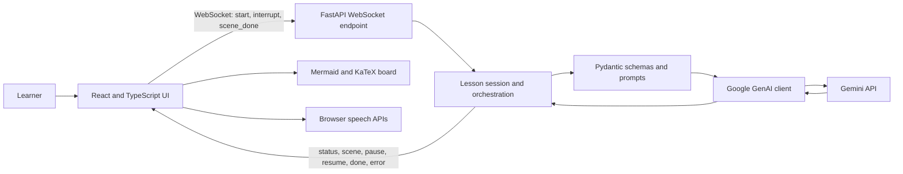

# Digital Board

Digital Board is an AI guided teaching workspace that turns a learner's question into a short, interactive lesson. Instead of returning a single block of chat text, it presents a sequence of narrated scenes and builds a visual board alongside the explanation.

> **Runtime model:** Digital Board is an online application. Lesson generation uses the Gemini API through a Python backend. The browser never receives the provider API key, and no model is hosted locally by this project.

## The problem

Many learning tools either give learners static material to read or a conversational answer that is difficult to follow as a lesson. Learners often need an explanation broken into steps, a visual aid at the right moment, a way to ask questions without losing their place, and a way to adapt the explanation when it is too advanced.

Digital Board addresses that gap by structuring a topic into a small lesson plan, generating each scene as typed content, and presenting the content progressively. Learners can ask a question, repeat or simplify an explanation, or move to a new topic while the lesson is in progress.

## Product capabilities

- Choose a topic and a learning level to create a multi scene lesson.
- Follow short, spoken explanations while diagrams, key points, and formulas appear on the board.
- Ask a typed question during the lesson; use browser speech recognition when available.
- Ask the tutor to repeat or simplify an explanation, or switch to another topic.
- See connection and lesson status, scene progress, and recoverable errors in the interface.

## Technology stack

| Layer | Technologies | Responsibility |
| --- | --- | --- |
| User interface | React 19, TypeScript, Vite 8 | Interactive lesson workspace, board, lesson controls, and connection state |
| Visual rendering | Mermaid 12, KaTeX 0.19 | Render generated diagrams and mathematical notation |
| Browser capabilities | Web Speech API | Speech synthesis for narration and optional speech recognition for questions |
| Application server | Python, FastAPI, Uvicorn | Health route, WebSocket sessions, lesson orchestration, and error handling |
| Data contracts | Pydantic | Validate lesson plans, scenes, board actions, and interruption intents |
| Generative AI | Google GenAI Python SDK and Gemini API | Generate structured lesson plans, scenes, and responses to learner interruptions |
| Configuration | `python-dotenv`, environment variables | Load backend secrets locally and configure service URLs and model names |

## Architecture

The system is organized as a browser presentation layer, a real time application layer, a lesson orchestration layer, a schema/prompt layer, and an external model provider. The API key is held by the backend only.



### Request and lesson flow

1. The browser opens a WebSocket connection to the backend at `/ws`.
2. The learner starts a lesson with a topic and level. The backend creates a lesson plan through the Gemini API.
3. The backend generates one scene at a time and sends structured scene data to the browser.
4. The browser renders board actions and narrates each scene. After the scene finishes, the browser sends `scene_done` so the backend can continue.
5. An interruption pauses progression while the backend classifies the learner's request and generates a question response, repeat, simplification, stop, or new topic action.

### Main components

- `frontend/src/App.tsx` manages the WebSocket lifecycle, lesson state, board actions, and browser speech interactions.
- `backend/main.py` exposes `/health`, `/test`, and the `/ws` endpoint.
- `backend/orchestrator.py` coordinates lesson planning, scene delivery, and interruption handling.
- `backend/prompts.py` defines planner, scene writer, and intent router instructions.
- `backend/schemas.py` defines the Pydantic data contracts returned by the model.
- `backend/llm.py` calls the Gemini API, parses structured JSON, and handles provider retries and failures.

## Requirements

- Python 3.10 or newer
- Node.js 20.19+ or 22.12+ (Vite 8 requirement)
- npm
- A Gemini API key and access to one or more models configured for the backend

## Local development

### 1. Set up the backend

Run these PowerShell commands from the repository root:

```powershell
py -3 -m venv .venv
.\.venv\Scripts\Activate.ps1
python -m pip install -r backend\requirements.txt
Copy-Item backend\.env.example backend\.env
```

Open `backend/.env` and set `GEMINI_API_KEY` to your Gemini API key. For deployments that already use an environment variable named `Gemini`, the backend accepts that name as a fallback; `GEMINI_API_KEY` takes precedence if both are set. `GEMINI_MODEL` is tried first; `GEMMA_MODEL` and a secondary Gemma model are fallbacks. Confirm that the chosen model names are enabled for your API project. Never commit `backend/.env`.

### 2. Set up the frontend

```powershell
cd frontend
npm install
Copy-Item .env.example .env
```

The default `VITE_BACKEND_URL` is `http://localhost:8000`. This value is compiled into the frontend, so set it to the backend's public origin when building for deployment. Do not put provider secrets in frontend environment variables; `VITE_*` values are visible to browsers.

### 3. Run the services

Start the backend in a terminal from the repository root:

```powershell
.\.venv\Scripts\Activate.ps1
python -m uvicorn main:app --app-dir backend --reload --host 127.0.0.1 --port 8000
```

Start the frontend in a second terminal:

```powershell
cd frontend
npm run dev
```

Open the URL printed by Vite (typically `http://localhost:5173`). Check backend availability at `http://localhost:8000/health`. The optional `GET /test` endpoint calls the model and returns a sample plan and scene, so it requires a valid API key and consumes API quota.

## Configuration

### Backend: `backend/.env`

| Variable | Required | Description |
| --- | --- | --- |
| `GEMINI_API_KEY` or `Gemini` | Yes | Secret API key used by the backend to call Gemini. The standard `GEMINI_API_KEY` name takes precedence if both are set. |
| `GEMINI_MODEL` | No | Primary model name; defaults to `gemini-3.5-flash-lite` in the current code |
| `GEMMA_MODEL` | No | First fallback model name; defaults to `gemma-4-26b-a4b-it` in the current code |

The backend also includes `gemma-4-31b-it` as a final fallback. Model availability can vary by API account and may require updating these settings.

### Frontend: `frontend/.env`

| Variable | Required | Description |
| --- | --- | --- |
| `VITE_BACKEND_URL` | No | HTTP(S) origin of the backend; defaults to `http://localhost:8000` |

## API and WebSocket contract

| Route / message | Direction | Purpose |
| --- | --- | --- |
| `GET /health` | Browser or monitor → backend | Liveness check |
| `GET /test?topic=...` | Browser → backend | Generates a sample plan and first scene |
| `WS /ws` `start` | Browser → backend | Begin a lesson with `topic` and `level` |
| `WS /ws` `interrupt` | Browser → backend | Ask a question or issue a lesson control request via `text` |
| `WS /ws` `scene_done` | Browser → backend | Signal that narration and display of the current scene finished |
| `WS /ws` `status`, `scene`, `pause`, `resume`, `done`, `error` | Backend → browser | Stream lesson progress, content, and control state |

## Deployment

The frontend and backend can be deployed separately or behind a reverse proxy. The hosting setup must support persistent WebSocket connections.

1. Deploy the backend and provide `GEMINI_API_KEY` as a server side secret. Set the desired model names as environment variables.
2. Deploy/build the frontend with `VITE_BACKEND_URL` set to the backend's public HTTPS origin.
3. Configure the backend CORS policy for the exact frontend origin. The current development configuration allows all origins and should be narrowed before public deployment.
4. Configure the proxy and browser endpoints for HTTPS and secure WebSockets (`wss://`).
5. Confirm the `/health` route and WebSocket upgrade behavior from the deployed frontend.

Speech synthesis and recognition are browser features. Recognition support and permissions vary by browser and operating system; typed questions remain available when speech recognition is unavailable.

## Security and privacy

- Keep API keys in `backend/.env` for local work or in the backend host's secret manager for deployment.
- Never add secrets to source files, frontend variables, issue reports, screenshots, or commits.
- `.gitignore` excludes environment files and local build/dependency directories; `.env.example` files contain placeholders.
- Lesson topics and user questions are sent to the configured Gemini API for generation. Review the provider's current data handling and retention terms before using sensitive or personally identifying information.
- Before exposing a deployment publicly, restrict CORS and apply the hosting platform's rate limits and access controls as appropriate.

## Troubleshooting

| Symptom | Checks |
| --- | --- |
| Backend stops during startup | Confirm `backend/.env` exists and `GEMINI_API_KEY` is set in the backend process environment. |
| Browser shows server disconnected | Confirm the backend is running, `VITE_BACKEND_URL` is correct, and the proxy supports WebSockets. Restart the Vite process after changing its environment file. |
| Model request fails | Check API key validity, quota/billing, network access, model availability, and backend logs. Adjust `GEMINI_MODEL` / `GEMMA_MODEL` for models enabled on your account. |
| Diagram does not render | Check the model-generated Mermaid syntax and backend response. The board shows a fallback message for invalid diagram content. |
| Voice question does not work | Grant microphone access and use a browser with Speech Recognition support, or type the question. |

## Repository layout

```text
backend/       FastAPI server, lesson orchestration, Gemini integration, schemas, prompts
frontend/      React and TypeScript web application
README.md      Product, architecture, setup, configuration, and deployment guide
SKILL.md       Repository-specific instructions for coding agents
```

## License

No license has been added yet. Unless a license is added to this repository, all rights remain with the copyright holder and reuse is not automatically granted.
